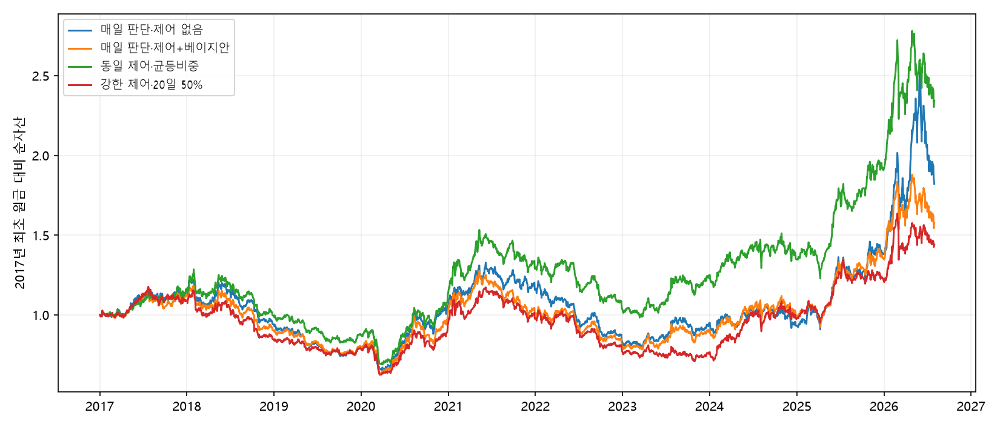
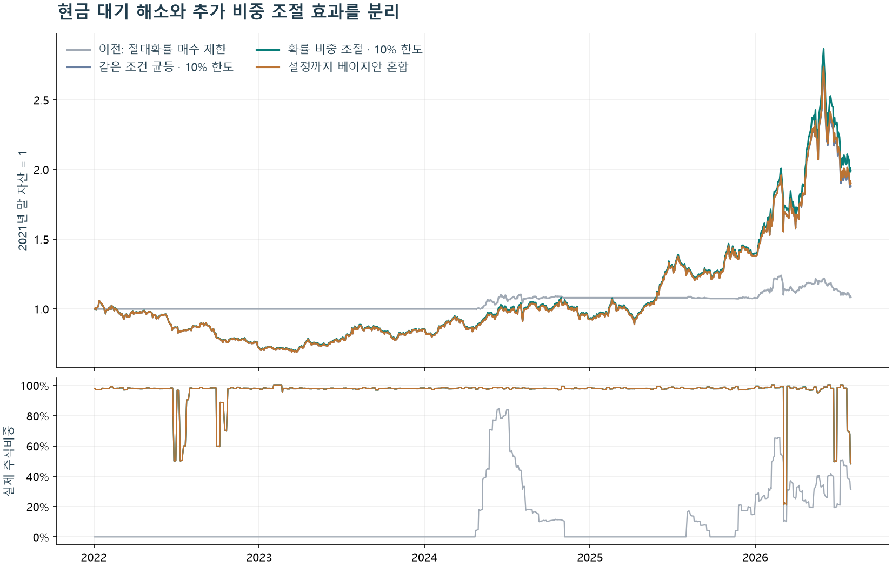

# Bayesian 52-Week High Research

**진행 중 · 52주 신고가 신호와 베이지안 포트폴리오 비중**

[실험 현황](IN_PROGRESS.md) · [결과 그래프](reports/) · [연구 코드](research/)

## 연구 질문

52주 최고가에 대한 가격 근접도와 종목 간 순위로 후보를 구성하고, 베이지안 회귀의 사후 불확실성을 비용 반영 종목비중에 연결한다. 보유 주기와 매일 판단 방식, 회전율 제어에 따른 차이를 비교한다.

## 실험 단계

| 단계 | 코드 | 비교 내용 |
|---|---|---|
| 기준 전략 | [high52_study](research/high52_study/) | 신고가 신호·보유기간 |
| 베이지안 보유 | [high52_bayes](research/high52_bayes/) | 불확실성과 보유 판단 |
| 비중 최적화 | [high52_bayes_optimized](research/high52_bayes_optimized/) | 상대 확률·종목비중 |
| 매일 판단 | [high52_daily](research/high52_daily/) | 일별 선정·청산·재배분 |
| 회전율 제어 | [high52_daily_control](research/high52_daily_control/) | 거래 감소 규칙 · 후속 검증 중 |

## 회전율 제어 실험

| 2017년 이후 전체 평가 | CAGR |
|---|---:|
| CONTROLLED | 4.88% |
| UNCONTROLLED | 6.46% |

출처: [성과표](reports/high52_daily_control/performance.csv). 회전율 감소가 수익률 개선으로 이어지지는 않았다. 반복 관찰한 표본, 수정주가의 분수 단위, 기업행위 근사에 따른 한계가 있다. 사후 확률은 실제 거래 승률과 다르다.

추가 그래프 · 비중 최적화 실험

[성과표](reports/high52_bayes_optimized/performance.csv) · [연도별 결과](reports/high52_bayes_optimized/annual_results.csv)

## 진행 상태

원본 Excel부터 실험까지의 통합 재현, 후속 표본 평가, 공동 연구 버전 대조가 남아 있다. 현재 결과는 중간 실험 기록이다.

공동 연구: [bayesian-strategy-allocation / part1_momentum](https://github.com/minjunxjang/bayesian-strategy-allocation/tree/main/part1_momentum). 공동 저장소 최신본과의 일치 여부와 개인별 기여 범위는 아직 확정되지 않았다.

입력과 실행 의존성

`inputs.npz`의 기본 필드는 `dates`, `codes`, `p`(수정주가), `v`(거래량), `m`(편입 마스크), `settlement`, `benchmark`다. 원본 입력과 입력 스냅샷은 공개 저장소에 포함하지 않는다. 기준 연구에는 추가 필드와 `portable_inputs` 의존성이 있다.

optimized: `rebuild_posterior.py` → `study.py train` → `study.py evaluate` → `validate.py` → `diagnostics.py` → `report.py`.

daily·daily_control 검증에는 이전 단계의 비교결과도 필요하다. H=5/20, W=504/1008 등 실험 설정은 각 `protocol.json`에 있다. HTML 보고서 일부 링크는 별도로 재생성해야 하는 상세 데이터를 가리킨다.

실행 폴더 구성: `python prepare_run.py --run-id research_001`. 전체 재현 경로는 통합 중이다.

[데이터 범위](DATA_POLICY.md)
